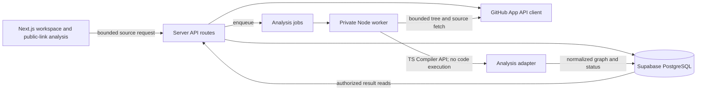
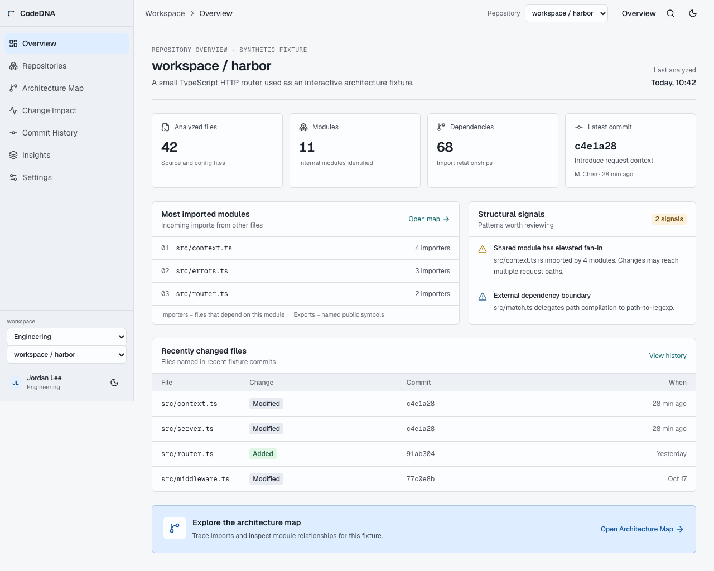
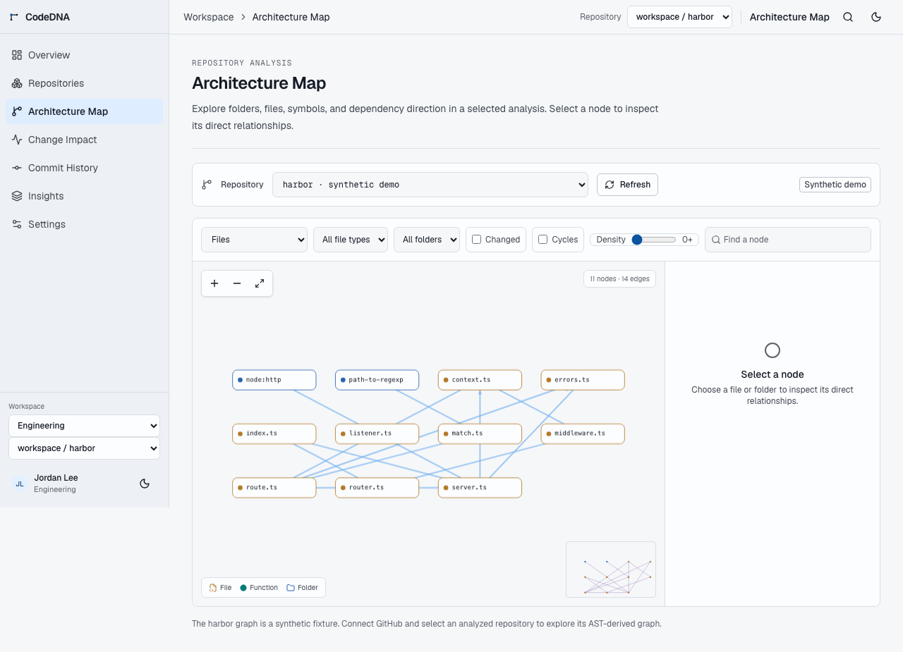
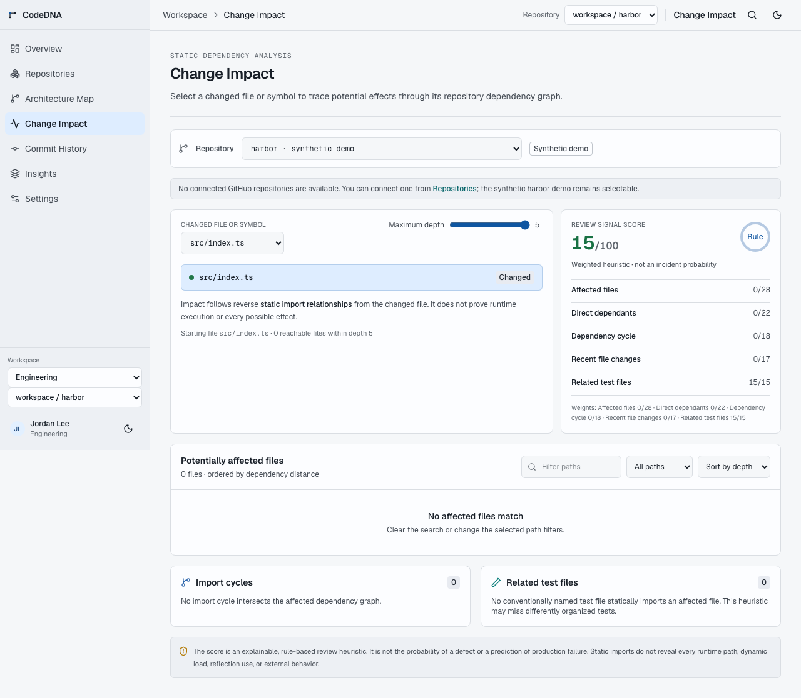
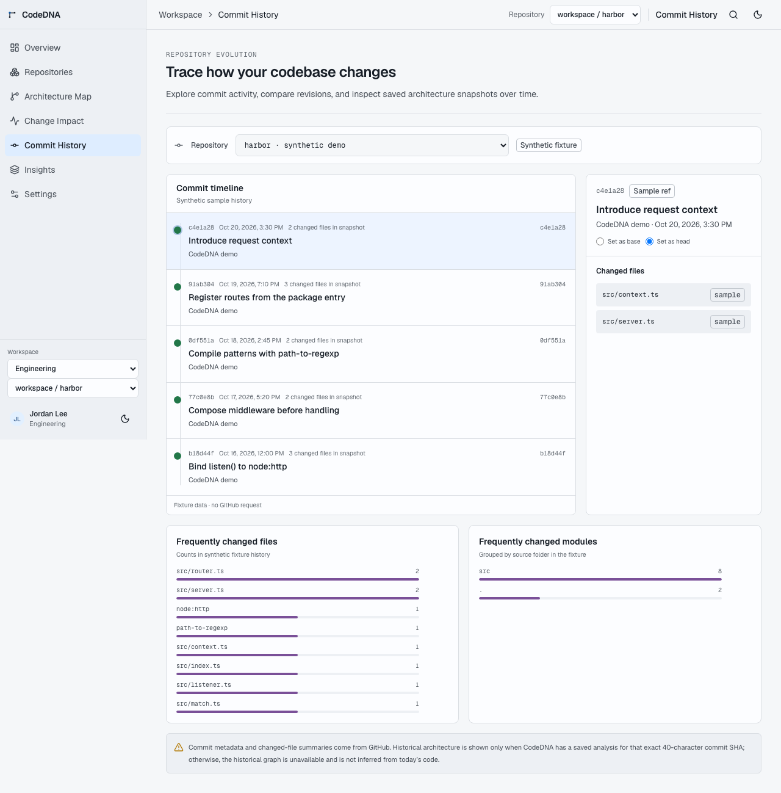

# CodeDNA

CodeDNA is a developer workspace for exploring repository structure, dependency relationships, and change history. The primary flow starts with a public GitHub repository link; its analysis powers Overview, Architecture Map, Change Impact, Insights, and recent commit summaries. GitHub account linking is temporarily paused.

## Requirements

- Node.js 20.9 or newer for the Next.js application and background worker.
- pnpm 10 or newer.
- Supabase project with PostgreSQL and the service role API enabled for GitHub integration.

## 1. Problem and solution

Large codebases are difficult to understand from files and commit messages alone. CodeDNA turns a public JavaScript/TypeScript repository into an explorable dependency graph, a bounded static change-impact view, and a recent commit timeline.

## 2. Features

- Anonymous, bounded analysis for public GitHub repository links (JavaScript/TypeScript; up to 24 supported files). Results power repository-specific overview, architecture, impact, insights, and recent commits in the current browser tab session.
- GitHub App account authorization and permission-scoped repository analysis are retained in the server code but the connection entry point and UI are temporarily disabled.
- Background TypeScript/JavaScript analysis with normalized nodes and edges, bounded inputs, and visible partial/error results.
- Search, graph detail levels, filters, keyboard navigation, and repository selection.

## 3. Architecture



See [architecture decisions](docs/adr/) for graph rendering, parsing, and background job choices.

## 4. Technology stack

Next.js 16, React 19, TypeScript, Tailwind CSS 4, Motion, Radix UI, Lucide, TypeScript Compiler API, GitHub App user authorization, Supabase/PostgreSQL, and Playwright. Production dependency licenses include MIT, Apache-2.0, ISC, BSD-3-Clause, 0BSD, CC-BY-4.0, and SIL Open Font License 1.1. See the lockfile-specific [dependency license review](docs/dependency-licenses.md).

## Local setup

```bash
corepack pnpm install
cp .env.example .env.local
corepack pnpm dev
```

The public site and public repository analysis work without a GitHub account. Repository results are temporarily held in the current browser tab session. GitHub account linking is currently paused.

## GitHub App and Supabase setup

1. Create a GitHub App. Set its callback URL to `http://localhost:3000/api/github/callback` for local work, then use the production origin for deployment.
2. Enable **User authorization (OAuth) during installation**. Enable expiring user access tokens so CodeDNA can refresh them server-side.
3. Grant only **Metadata: read-only** and **Contents: read-only** repository permissions. CodeDNA does not need write access, webhook permissions, or organization administration permissions.
4. Set the App installation policy to **Only select repositories** where possible. Users install the App and choose repositories from GitHub's own installation screen. CodeDNA lists only repositories returned by the App installation API.
5. Copy the App client ID, client secret, and App slug into `.env.local` as `GITHUB_APP_CLIENT_ID`, `GITHUB_APP_CLIENT_SECRET`, and `GITHUB_APP_SLUG`.
6. Create a Supabase project and set `SUPABASE_URL` and its **service role** key in `.env.local`. Never expose the service role key to client code or add a `NEXT_PUBLIC_` prefix.
7. Apply migrations in order: `202610200001_github_integration.sql`, `202610200002_static_analysis.sql`, `202610210001_repository_evolution.sql`, then `202610220001_production_hardening.sql` (for example, with the Supabase SQL editor or `supabase db push`). The tables have RLS enabled and no end-user policies; only server-side service-role calls can access them.
8. Generate independent secrets and put them in `.env.local`:

   ```bash
   openssl rand -base64 32  # CODEDNA_TOKEN_ENCRYPTION_KEY
   openssl rand -hex 32     # CODEDNA_SESSION_SECRET
   ```

   The first value must decode to exactly 32 bytes. Do not rotate it without re-encrypting existing rows in `github_connections`. Keep the session secret separate from the token encryption key.
9. Set `NEXT_PUBLIC_APP_URL` to the application origin, without a path or trailing route. HTTPS is required in production; localhost HTTP is permitted in development.
10. Start Next.js and the worker in separate terminals:

    ```bash
    # Terminal 1
    corepack pnpm dev
    ```

    ```bash
    # Terminal 2 (bash/zsh)
    set -a && source .env.local && set +a
    corepack pnpm worker:github
    ```

    Production worker platforms should inject the variables directly; Node does not automatically load `.env.local` for the standalone worker.

Repository Evolution loads commit metadata and bounded changed-file summaries from the GitHub Commits API. Commit comparisons are stored with a separate UUID per user, repository, and pair of full commit SHAs; patch contents are never sent to the browser or persisted. File and module frequency uses only distinct stored analysis snapshots and is labeled as sampled data. A historical architecture comparison is available only when CodeDNA has a saved analysis for the exact selected SHA; CodeDNA does not claim to reconstruct unrecorded historical graphs. GitHub pagination and rate-limit headers are surfaced in the timeline.

The worker must run continuously in a private worker environment with the same server-only Supabase and GitHub variables. Do not deploy it as a public HTTP endpoint. It claims jobs atomically with `FOR UPDATE SKIP LOCKED`, so multiple worker processes can share the queue safely; jobs abandoned by a crashed worker are reclaimed after 30 minutes, up to three attempts.

## 5. Environment variables

`.env.example` documents every application variable. Public origin is the only `NEXT_PUBLIC_` setting. GitHub App client secret, Supabase service-role key, token-encryption key, and session secret are server-only. For production, create independent values in the hosting provider's secret manager; never copy `.env.local` into a deployment artifact or commit real credentials. The token key must decode to exactly 32 bytes and requires a planned re-encryption before rotation. GitHub App callback URLs and `NEXT_PUBLIC_APP_URL` must use the final HTTPS deployment origin. `GITHUB_WORKER_POLL_MS` is optional and controls worker polling.

The GitHub integration is not production-ready until a GitHub App, Supabase project, production secrets, database migration, HTTPS origin, and private worker have been configured. The synthetic demo does not depend on them.

## 6. Test and release checks

```bash
corepack pnpm lint
corepack pnpm typecheck
corepack pnpm test:github
corepack pnpm test:analysis
corepack pnpm test:integration
corepack pnpm test:e2e
corepack pnpm build
corepack pnpm audit --prod
```

The integration test explicitly skips unless pointed at a disposable Supabase project. Playwright requires Chromium. `/api/health` is a liveness check only; it does not claim that GitHub, Supabase, or the background worker are available. Apply SQL migrations in filename order using the Supabase CLI or SQL editor, and verify the plan against a staging database before production. Migration application cannot be verified without a configured Supabase project.

## 7. Security approach

OAuth state and session cookies are signed and HttpOnly; mutating browser routes enforce Origin checks. Tokens are encrypted at rest with AES-256-GCM, and server-only service credentials are never returned to browser code. GitHub API origins are fixed, authorization is scoped to the user's installed/selected repositories, and database reads include the authenticated user. Analysis bounds paths, tree sizes, supported files, file sizes, and total input; it does not execute repository code or install dependencies. See [GitHub authorization and data handling](#github-authorization-and-data-handling) and [Architecture decisions, security boundaries, and limits](#architecture-decisions-security-boundaries-and-limits).

## 8. Analysis limits

Static imports and locally resolvable calls do not capture every runtime relationship. Dynamic imports, reflection, generated code, runtime dispatch, and comprehensive cross-file call resolution are incomplete. Change impact is a review heuristic, not a failure-probability estimate. Historical graphs are available only for commits that were actually analyzed and saved. Large or unsupported inputs may yield partial analysis.

## 9. Known issues and next steps

- A real deployment URL is not available from this checkout. No hosting provider, production origin, GitHub App credentials, or Supabase project is configured here.
- Migration syntax/order is tracked in `supabase/migrations/`, but applying migrations to a live or staging database still requires the project credentials and operator environment.
- Next.js request failures and selected API errors produce structured metadata-only server logs; tokens, request bodies, and source contents are not included. No external error-monitoring/alerting provider or worker queue telemetry is configured. `/api/health` is a liveness probe.
- The project currently has no `LICENSE` file. The application license is a repository-owner decision; do not infer an open-source grant from the dependency licenses.
- Future work: configurable retention/cleanup, worker health telemetry, historical re-analysis workflows, and additional parser adapters.

## 10. Demo and portfolio

Enter a public GitHub repository URL at `/repositories` to populate the workspace. The `/demo` route redirects there. Screenshots in [`docs/screenshots/`](docs/screenshots/) are illustrative product UI captures and not customer evidence. Technical decisions and tradeoffs are documented in the [ADR set](docs/adr/).









## GitHub authorization and data handling

GitHub account linking is currently paused: the product UI does not offer account connection, and `/api/github/connect` redirects to the public repository analyzer. The OAuth, worker, and storage implementation below documents the retained integration code for a future re-enable. The public-link preview uses fixed GitHub API/raw-content hosts, accepts only canonical public GitHub repository URLs, and is bounded by a per-process request limit, file count, file size, and total input size. It returns a temporary in-memory response and does not persist repository source or analysis results.

- CodeDNA uses GitHub App user authorization, not a broad classic OAuth `repo` scope. Repository visibility is bounded by the repositories selected in the App installation.
- OAuth `state` is random, signed, short-lived, stored in an HttpOnly SameSite cookie, and verified on callback. Session cookies are signed, HttpOnly, SameSite, and Secure in production. Mutating browser routes check the request Origin.
- GitHub access and refresh tokens are encrypted with AES-256-GCM before storage. They are never returned to the browser or written to logs. The browser receives only a signed session cookie containing the GitHub account ID and login.
- Supabase service credentials are only used in server routes and the worker. Repository and job reads include the authenticated GitHub user ID. The database schema enables RLS and grants the server role the required access.
- Repository metadata is validated and bounded before storage. The worker reads the default branch tree and downloads only supported JavaScript/TypeScript text blobs from the selected repository. It never installs packages, builds the repository, or executes repository code. Symlinks, unsafe paths, binary content, files above 1 MiB, trees above 20,000 entries, more than 300 supported files, and source downloads above 20 MiB are excluded or reported. Analysis results are cached by repository commit and TypeScript parser version.
- The TypeScript Compiler API produces normalized file/module/function/class nodes and import/export/call edges. Import edges are distinct from calls; unresolved relative imports are marked with unknown confidence. Calls are emitted only for identifier calls resolved to a function declared in the same file. Syntax and skip diagnostics accompany the graph.
- Change Impact traverses reverse static import edges with a bounded breadth-first search, detects affected import cycles, and recognizes test files only when a conventionally named test source statically imports an affected file. Its configurable 100-point review heuristic weights affected-file count (28), direct dependants (22), cycles (18), recent stored commit changes (17), and missing related tests (15). The score is not a defect probability or production-failure prediction; dynamic/runtime effects remain outside this static graph.
- The retained account integration handles rate limits, expired authorization, unavailable repositories, permission denials, and worker failures. Its Settings connection controls are hidden while account linking is paused; use GitHub's application settings to revoke a previously granted authorization.
- Analysis work is queued and runs outside the browser request. If the worker is stopped, jobs remain queued until it resumes.

## Architecture decisions, security boundaries, and limits

- The Next.js application is a server-rendered UI with client components only for interactive workspaces. The GitHub API client and Supabase store are server-only modules. The background worker owns repository download and static analysis so HTTP requests do not execute repository code or wait for analysis to finish.
- GitHub App authorization is the identity boundary. A signed, HttpOnly session cookie identifies the GitHub user; every repository and analysis lookup uses that user ID and a user-repository grant. PostgreSQL RLS is enabled and no browser role has policies or table grants. Service-role access is limited to server code and the private worker.
- The fixed-window limiter in `202610220001_production_hardening.sql` is shared across app instances: GitHub-backed reads allow 60 requests per user/minute, analysis status reads allow 120/minute, and job creation allows 5 per user/10 minutes. It fails closed if the database limiter is unavailable. These values should be revisited using deployment traffic and abuse telemetry.
- API requests use fixed GitHub and Supabase origins. GitHub pagination links are accepted only from `api.github.com`; repository names and paths are normalized and path traversal, symlinks, binary files, and oversized source inputs are rejected. Public-link analysis accepts only `https://github.com/{owner}/{repo}` and fetches files from fixed GitHub API and raw-content hosts.
- The parser does not install dependencies or run source. Its graph and impact results are static approximations: dynamic imports, reflection, runtime dispatch, generated code, and cross-file call resolution are not complete. Stored historical graphs exist only for commits that CodeDNA has analyzed.
- Repository metadata is shared by GitHub repository ID, while grants, credentials, analyses, jobs, and commit comparisons are scoped to user IDs. Removing a grant immediately blocks application reads, but metadata retention for repositories no user can access and rate-limit row cleanup require an operational retention policy before high-volume production.
- Graph rendering caps visible nodes and edges; folder view is the intended first view for larger analysis results. Very large repositories are bounded at ingestion, so an analysis can be partial.
- OAuth relies on secure deployment configuration and GitHub's authorization/code exchange. Configure a distinct production origin, HTTPS, secrets manager, database backups, migration rollout, worker monitoring, and token-key rotation procedures before exposing private repository analysis to users. The current deployment has no distributed job observability or external alerting configured.

## Verification

Run the available checks with the same Node/pnpm major versions used for development:

```bash
corepack pnpm lint
corepack pnpm typecheck
corepack pnpm test:github
corepack pnpm test:analysis
corepack pnpm test:integration
corepack pnpm test:e2e
corepack pnpm audit --prod
```

Playwright E2E requires the Chromium browser binary (`corepack pnpm exec playwright install chromium`). The E2E suite exercises the product-to-demo flow, graph keyboard interaction and detail-level selection, mobile navigation, and unauthenticated/cross-origin analysis API rejection. A live GitHub/Supabase integration test requires configured credentials and a disposable test database; tests must never use production repository data.

For the opt-in data integration suite, use a separate Supabase project with all migrations applied and set `CODEDNA_TEST_DATABASE_DISPOSABLE=true`, `CODEDNA_TEST_SUPABASE_URL`, and `CODEDNA_TEST_SUPABASE_SERVICE_ROLE_KEY` only in the test process environment. It creates and deletes unique fixture users and a fixture repository, checks user grant isolation, and exercises the database-backed rate-limit RPC. With those values absent, the test is reported as skipped rather than passed.

## Routes

- `/` — product site
- `/demo` — redirects to public repository analysis
- `/workspace` — workspace overview
- `/repositories` — GitHub connection, repository selection, and analysis status
- `/architecture`, `/impact`, `/history`, `/insights`, `/settings` — workspace tools
- `/foundation`, `/showcase` — interface foundation and component inventory
- `/api/health` — web-process liveness response (no provider or worker readiness claim)

## Commands

| Command | Purpose |
| --- | --- |
| `corepack pnpm dev` | Start the web application |
| `corepack pnpm worker:github` | Run the asynchronous GitHub analysis worker |
| `corepack pnpm build` | Create a production build |
| `corepack pnpm lint` | Run ESLint |
| `corepack pnpm typecheck` | Run TypeScript checks |
| `corepack pnpm test:github` | Run OAuth, credential encryption, metadata validation, and error handling tests (Node 22.6+) |
| `corepack pnpm test:analysis` | Run static analysis and change-impact traversal tests |
| `corepack pnpm test:e2e` | Run Chromium product, workspace graph, responsive navigation, and API guard flows |
| `corepack pnpm audit --prod` | Check production dependencies against the npm advisory service |
| `corepack pnpm test` | Run integration security and static analysis tests |

## Project structure

```text
src/app/api/github/       # OAuth and authenticated API routes
src/lib/github/           # GitHub client, session security, data access, validation
src/lib/analysis/         # TypeScript/JavaScript parser adapter and normalized graph engine
src/lib/repositories/     # Repository domain types and demo data source
supabase/migrations/      # Private integration tables and queue function
scripts/                  # Background analysis worker
tests/                    # GitHub integration security and static analysis tests
```
# deneme
